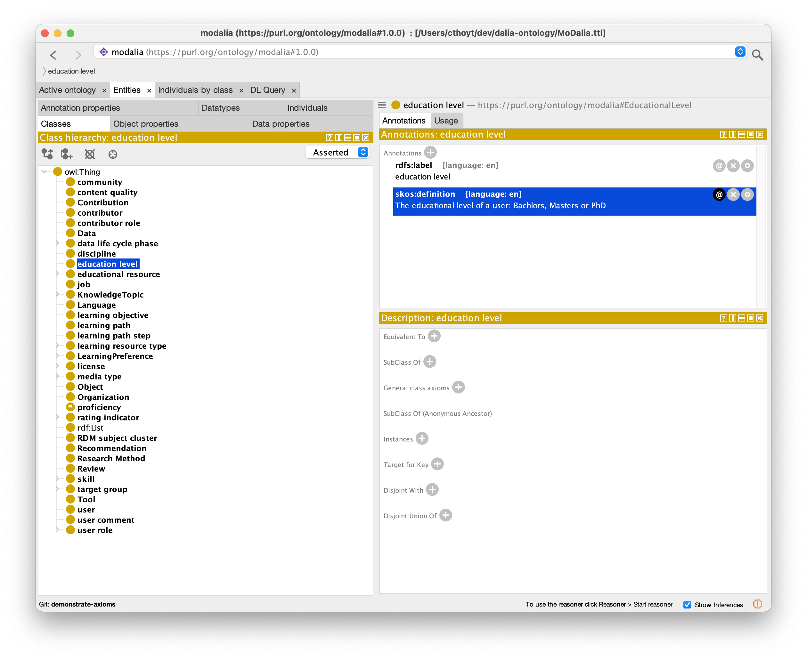
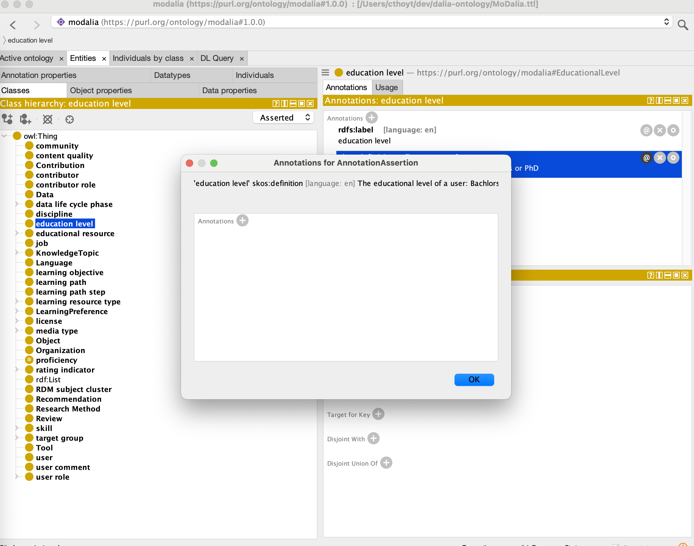
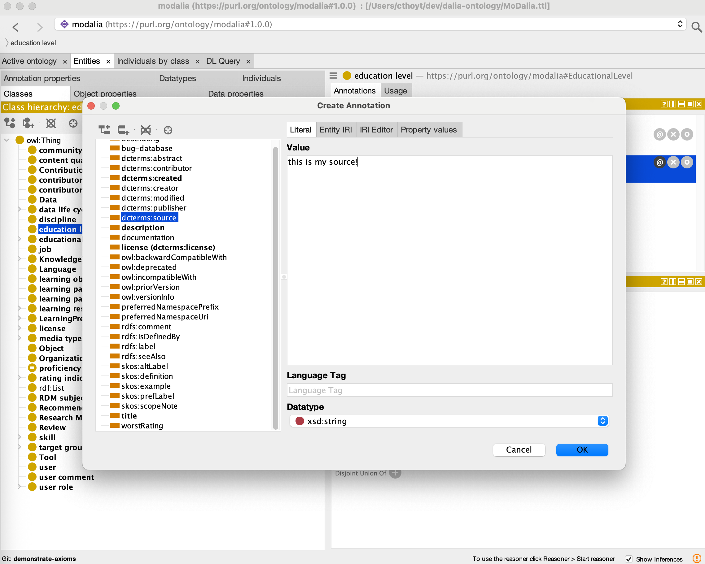
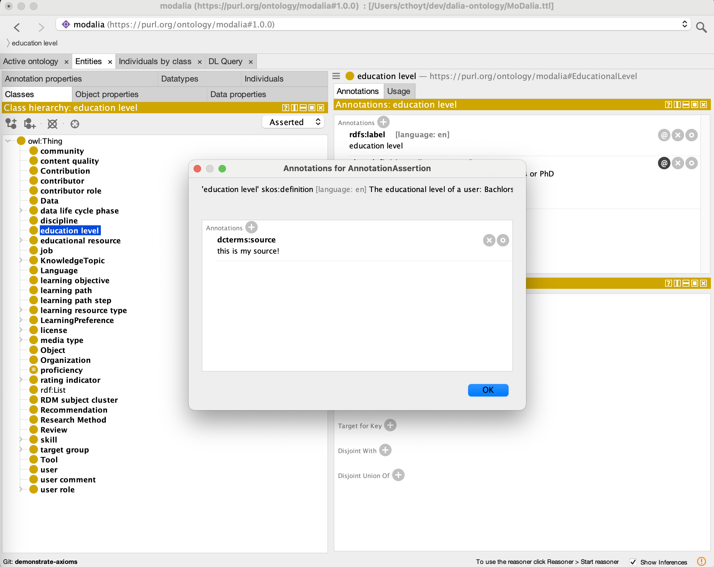
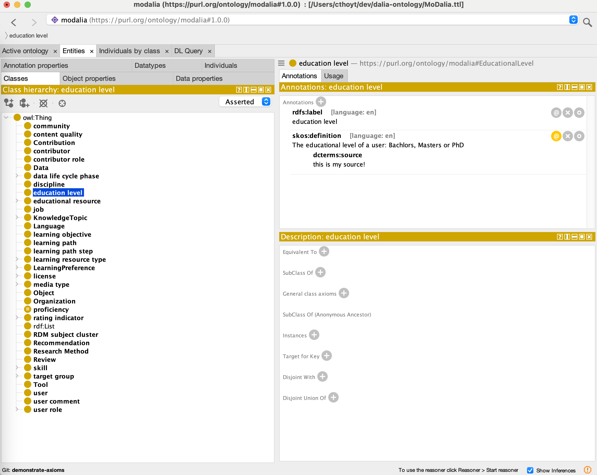

# Curating Axioms

## Background

An _axiom_ is the name for extra information attached to a triple in an OWL
ontology. For example, a triple might be
`rec:recommender dcterms:description "A community which ..."` that gives a
description. If we want to annotate that this description was written by a
specific person, or comes from a specific source, we can use an axiom to
annotate this. In turtle, this looks like:

```turtle
[ rdf:type owl:Axiom ;
   owl:annotatedSource rec:recommender ;
   owl:annotatedProperty dcterms:description ;
   owl:annotatedTarget "A community which provides the recommendation of the OER. In the context of DIF, the recommending community is the organization or institution or project or body or online group which recommends the OER." ;
   dcterms:contributor <https://orcid.org/0000-0001-8997-2620> ,
                       <https://orcid.org/0000-0002-0452-7075> ;
   dcterms:source "DIF1.3" ,
                  "recommendationontology"
 ] .
```

## Tutorial

Open up the ontology file `MoDalia.ttl` in Protégé and navigate to the term
where you want to annotate an axiom. In this example, we'll use the
`skos:definition` for the `education level` class. Click on the `@` symbol



This brings up the "annotations" menu. You can click the plus next to
"annotations" to add one.



Now, you can search the list for the predicate you want on the left hand side
and type in either a literal value or IRI for the value. In this example, I used
`dcterms:source` and with text.



Now, click okay in the "Create Annotation Window" then once more in the
"Annotations for ..." window



Now, you can see your annotations appearing under the top-level assertion


